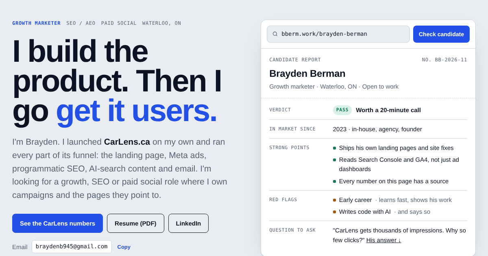

# bberm.work

Portfolio site for **Brayden Berman**, a growth marketer in Waterloo, ON (SEO / AEO, paid social, landing pages).

**Live:** [bberm.work](https://bberm.work)



## What's on it

- **A candidate report.** The hero is styled like the used-car listing reports from [CarLens](https://carlens.ca), applied to me: verdict, strong points, red flags and a question to ask.
- **The CarLens case study.** Real Google Search Console data (Aug–Oct 2026): average position from #33 to #12.6, 6.5K impressions across 699 queries and 415 AI Overview / AI Mode impressions. There's a section on what *hasn't* worked yet too.
- **Every number has a source.** Each stat is labeled with where it came from. Reach isn't presented as conversions.
- **A custom 404.** Visit any broken link, like [bberm.work/anything](https://bberm.work/anything), to get a "Listing not found" report.

## How it's built

- Plain HTML, CSS and a little JavaScript. No framework and no build step.
- The chart is drawn in vanilla JS as inline SVG from weekly Search Console data.
- Light and dark mode follow the visitor's system setting.
- SEO basics: meta and Open Graph tags, `Person` schema (JSON-LD), `sitemap.xml` and `robots.txt`.
- Hosted on Cloudflare Pages. Built with Claude Code.

## Files

```
index.html                  the whole site
404.html                    custom not-found page
assets/                     screenshots and ad creative (WebP)
Brayden_Berman_Resume.pdf   resume
og-cover.png                social share image
favicon.ico, favicon-48.png, apple-touch-icon.png, icon-512.png
sitemap.xml, robots.txt
```

## Run it locally

No install needed. Open `index.html` in a browser, or serve the folder:

```
python3 -m http.server 8000
```

## Contact

braydenb945@gmail.com · [LinkedIn](https://www.linkedin.com/in/brayden-berman-907437337)
